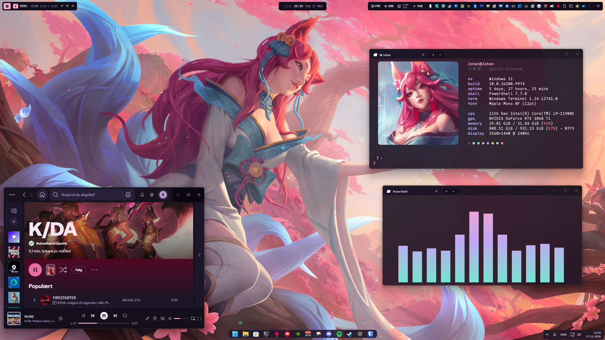
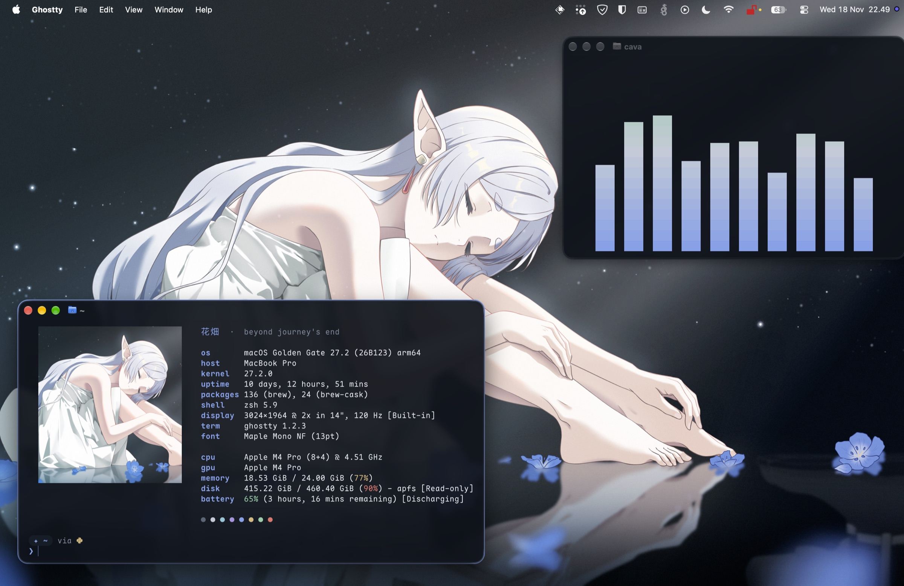

# dotfiles

My dotfiles. They cover a Windows 11 machine, themed after the Spirit Blossom Ahri skin from League of Legends, and a MacBook Pro with two themes, Frieren and Shinkai skies. Each operating system has its own folder. The color palettes and the script that renders them into app configs sit at the root and are shared.





| Platform | Folder | Notes |
|---|---|---|
| Windows 11 | [`windows/`](windows/README.md) | Zebar bar, taskbar restyled as a dock, no tiling WM |
| macOS | [`macos/`](macos/README.md) | native menu bar, JankyBorders, hidden Dock, theme switching with `theme.sh` |

## Layout

```
palettes/           one <theme>.json per theme: colors, roles and fonts
render.py           renders <os>/templates into <os>/generated and copies the results into place
windows/
  README.md         Windows setup, bootstrap and troubleshooting
  themes            the themes this platform supports, default first
  install.ps1       bootstrap, runs everything in install/ in order
  install/          scripts for targets that need more than a file copy
  templates/        app configs with palette placeholders
  deploy.d/         where each rendered file is copied to
  assets/           prebuilt files (cursors) and the screenshot
macos/
  README.md         Mac setup, bootstrap and theme switching
  themes            frieren first, then shinkai
  install.sh        bootstrap, runs everything in install/ in order
  theme.sh          switches every app to another theme
  Brewfile          the tools, apps and fonts
  wallpapers.json   where each theme's wallpaper and logo come from
  assets/           the screenshot
  install/, templates/, deploy.d/   as on Windows
```

Each platform folder also gets `generated/` (rendered output, plus the resolved `palette.json` for install scripts), `backup/` (registry exports and original configs) and `.current-theme`. All three are machine-local and gitignored.

## Theming

Each theme is one file in `palettes/`, named after its slug. A palette has these parts:

- `colors`: named hex values (`base`, `surface0`, `sakura`, `lavender`, `spirit` and so on, plus `ansi0` to `ansi15`).
- `roles`: names that point at a color, such as `"accent": "sakura"`. Templates can use a role anywhere they can use a color, so changing `accent` to `lavender` moves the accent in every app at once.
- `fonts`: `mono`, `ui` and `display`.
- `name` and `slug`, plus optional `flair` and `tagline` strings that bars and greeters can show.
- `aa`: when `true`, `--check` also fails if text, roles or ANSI colors miss WCAG AA contrast on `base`, `surface0` or `surface1`.

The theme comes from `--theme <slug>`, then `<os>/.current-theme`, then the first line of `<os>/themes`.

Templates are plain config files with placeholders:

| Placeholder | Output |
|---|---|
| `{{ sakura }}` | `#f4a7c8` |
| `{{ sakura \| strip }}` | `f4a7c8` |
| `{{ sakura \| rgb }}` | `244, 167, 200` (`rgbs` gives `244 167 200`) |
| `{{ sakura \| rgba:0.6 }}` | `rgba(244, 167, 200, 0.6)` |
| `{{ sakura \| hexa:cc }}` | `#f4a7c8cc` |
| `{{ sakura \| abgr }}` | `4291340276`, a Windows `0xAABBGGRR` DWORD |
| `{{ sakura \| bgrhex }}` | `c8a7f4` |
| `{{ sakura \| argb }}` | `0xfff4a7c8` (`argb:cc` sets the alpha) |
| `{{ sakura \| float }}` | `0.957 0.655 0.784` |
| `{{ sakura \| r }}` | `244` (also `g`, `b`) |
| `{{ sakura \| ansi }}` | `38;2;244;167;200` (`ansibg` gives `48;2;...`) |
| `{{ font.mono }}` | `Maple Mono NF` |
| `{{ meta.name }}` | the palette name (any top-level key works, such as `meta.flair`) |

Keys have to start with a letter, so Go-template syntax such as `{{ .Path }}` or `{{ end }}` passes through untouched. An unknown key fails the render and names the file.

Each `deploy.d/*.json` file is a list of `{group, src, dst, if_exists}` entries. `src` is relative to `generated/`, `dst` can use environment variables, and an entry whose `if_exists` path is missing is skipped. That way, apps that aren't installed are left alone.

```powershell
py -3 render.py --check                          # validate every placeholder, write nothing
py -3 render.py                                  # render the current platform's templates
py -3 render.py --deploy                         # render, then copy every group into place
py -3 render.py --deploy terminal zebar          # render, then copy selected groups
py -3 render.py --out $env:TEMP\r --only zebar   # render one subtree to a scratch directory
py -3 render.py --os windows --check             # target a platform folder explicitly
py -3 render.py --check --all-themes             # validate against every theme the platform lists
py -3 render.py --theme frieren --deploy         # render and deploy one theme without switching to it
```

`render.py` picks the platform folder from the OS it runs on (`windows`, `linux` or `macos`). It needs Python 3 and nothing outside the standard library.

## Adding a platform

1. Create `<os>/templates/`, `<os>/deploy.d/` and `<os>/themes`. `render.py` finds them without any changes.
2. Start from the Windows templates that aren't tied to Windows: `starship.toml`, the Neovim colorscheme, the cava and fastfetch configs, and the Discord, Spotify and Zen themes. If two platforms end up sharing a template, move it to a shared folder at that point.
3. Add an installer and a README for the platform, and a row to the table at the top of this file.

## Kept out of the repo

Riot's artwork (the fastfetch logo and the lock screen splash) and the Mac wallpapers are downloaded at install time and never committed. Rendered output and backups are per-machine and gitignored.

The cursors in `windows/assets/cursors/` are a recolor of [Bibata](https://github.com/ful1e5/Bibata_Cursor), which is GPL-3.0; its license is in that folder.
