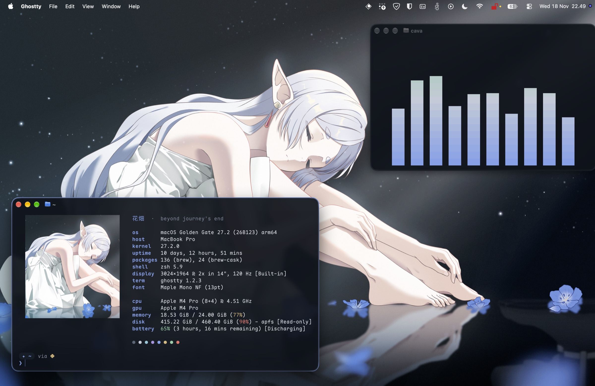

# macOS: Frieren and Shinkai skies

A setup for a 14" MacBook Pro with a notch, in two themes you switch between with one command. Frieren is the default: a night-sky base, moonweed blue accent, silver and gold. Shinkai skies is dark teal water with a sky blue second accent and warm brick. There is no tiling window manager. The native menu bar stays, without a background so it sits on the wallpaper. JankyBorders outlines the focused window, and the Dock stays hidden until you reach for it.



```sh
git clone https://github.com/bitknox/dotfiles ~/dotfiles
cd ~/dotfiles
macos/install.sh --dry-run   # show the plan
macos/install.sh             # run it
macos/theme.sh shinkai       # switch themes later
```

Commands in this file run from the repo root. File paths are relative to `macos/`. The palettes, the template syntax and `render.py` are described in the [root README](../README.md).

## Components

| Component | Tool | Files |
|---|---|---|
| Menu bar | native: no background, weekday and date in the clock, battery percentage | `install/menubar.sh` |
| Window borders | JankyBorders: accent when focused, surface2 otherwise | `templates/bar/borders/bordersrc`, `install/borders.sh` |
| Dock | `defaults`: hidden, 44 pt, no recent apps | `install/dock.sh` |
| Launcher | Raycast on Option-Space, plus a "Theme" app per theme | `install/raycast.sh` |
| Terminal | Ghostty with a generated theme | `templates/terminal/ghostty/` |
| Shell | zsh with Starship, zoxide, eza, bat, fzf and yazi | `templates/terminal/zsh/rice.zsh`, `templates/terminal/starship.toml`, `install/shell.sh` |
| Greeter | fastfetch, logo through the kitty graphics protocol | `templates/terminal/fastfetch/config.jsonc` |
| Visualizer | cava, listening to the system output | `templates/terminal/cava/config`, `install/cava.sh` |
| Wallpaper | one picture per theme, set on every desktop | `wallpapers.json`, `install/art.sh`, `install/wallpaper.sh` |
| Accent and dark mode | `defaults`: nearest accent preset, selection color from the palette | `install/appearance.sh` |
| Fonts | Maple Mono NF, SF Pro, Shippori Mincho | `Brewfile` |
| Discord | Vencord theme, also copied for Vesktop | `templates/apps/discord/`, `install/vencord.sh` |
| Spotify | Spicetify theme `Dotfiles` | `templates/apps/spicetify/Dotfiles/`, `install/spicetify.sh` |
| Zen | `userChrome.css`, `userContent.css` and the missing `user.js` prefs | `templates/apps/zen/`, `install/zen.sh` |
| Helium | unpacked Chromium theme | `templates/apps/helium/`, `install/helium.sh` |
| VS Code, Insiders and Cursor | one extension holding both themes, packed to `.vsix` locally | `templates/editors/vscode/`, `install/vscode.sh` |
| Xcode | `.xccolortheme`, one per theme | `templates/editors/xcode/`, `install/xcode.sh` |
| Android Studio | `.icls`, one per theme | `templates/editors/jetbrains/`, `install/android-studio.sh` |

Cursors are left alone, because macOS only changes them through an accessibility setting.

## The menu bar

The rice keeps the native menu bar. A custom bar that replaces it can't stop macOS from sliding the native one in over it when the pointer reaches the top edge, and the overlap felt worse than the stock bar. The `menubar` step sets what macOS 27 lets a script set: the clock shows the weekday and date, and the battery shows its percentage. Two settings live only in System Settings, Menu Bar, and the step prints them: turn off Show menu bar background, and show Sound and Now Playing under Menu Bar Controls.

## Switching themes

```sh
macos/theme.sh           # list the themes, the current one starred
macos/theme.sh shinkai   # switch
```

`theme.sh` writes `.current-theme`, renders and deploys, then has each app pick up the change. Borders and Ghostty reload in place. The wallpaper, the accent color, Zen, Spotify, Discord and the editor setting `workbench.colorTheme` follow. It ends with what still needs a click: a Zen restart, the Helium reload, and picking the theme in Xcode and Android Studio.

The apps "Theme Frieren" and "Theme Shinkai skies" in `~/Applications` run the same script, so typing "theme" in Raycast or Spotlight switches. Raycast itself stays unthemed, because custom themes need Raycast Pro; on the free plan it follows dark mode.

## Bootstrap

`install.sh` runs each script in `install/` in order. Every step checks first and is skipped with the reason when something is missing, a failing step doesn't stop the run, and a summary table prints at the end. Everything a step replaces is kept in `backup/` first: files under `backup/originals/`, `defaults` values in `backup/defaults.tsv`. Running it again is safe.

| Step | What it does |
|---|---|
| `brew` | `brew bundle` with the `Brewfile`. Nothing already installed is upgraded. |
| `render`, `deploy` | Checks every template against both themes, renders the current one, copies it into place. |
| `art` | Downloads each theme's wallpaper and cuts its fastfetch logo, a square crop of a picture, into `~/Library/Application Support/dotfiles/art/`. |
| `wallpaper` | Sets the current wallpaper on every desktop. |
| `shell` | Adds one line to `.zshrc` that sources `rice.zsh` and comments out `ZSH_THEME`. PATH lines stay. |
| `menubar` | Clock with weekday and date, battery percentage, and the two manual Menu Bar settings. |
| `borders` | Starts JankyBorders as a service. It asks for Accessibility permission once. |
| `dock` | Hidden Dock, 44 pt icons, no recent apps. |
| `appearance` | Dark mode, accent preset and selection color. |
| `raycast` | Builds the two Theme apps and prints the hotkey to set. |
| `vscode`, `xcode`, `android-studio` | Install both editor themes. |
| `zen`, `helium`, `spicetify`, `vencord` | Theme the apps that are present. |
| `cava` | cava config. cava captures the system output itself, so no audio routing changes; the first run asks for System Audio Recording permission. |

```sh
macos/install.sh --list            # every step
macos/install.sh --only dock,raycast
macos/install.sh --skip shell
```

## Undoing it

Each first original is in `backup/originals/<absolute path>`; copy it back. `backup/defaults.tsv` lists every `defaults` key the steps changed with its old value, where `missing` means it was unset (`defaults delete` it). Stop borders with `brew services stop borders`.
